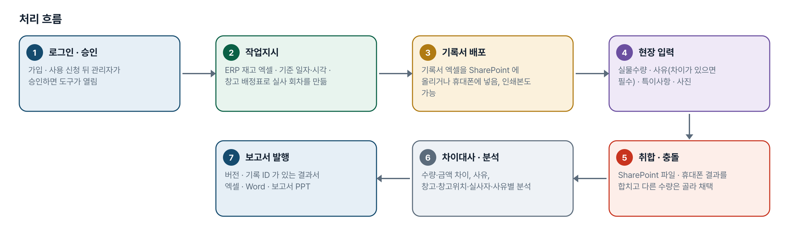
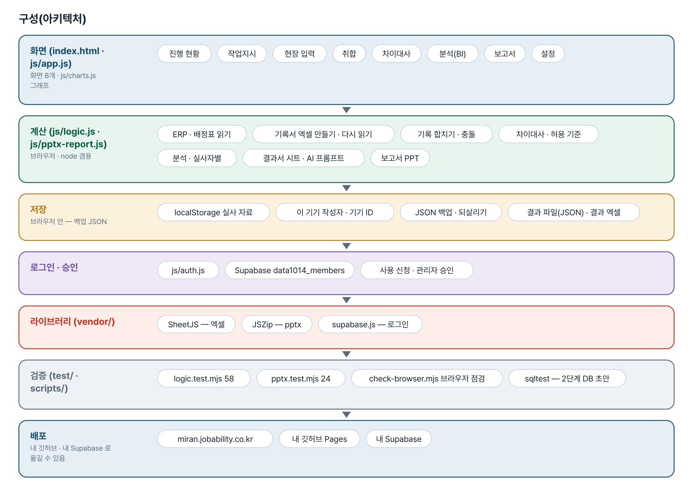
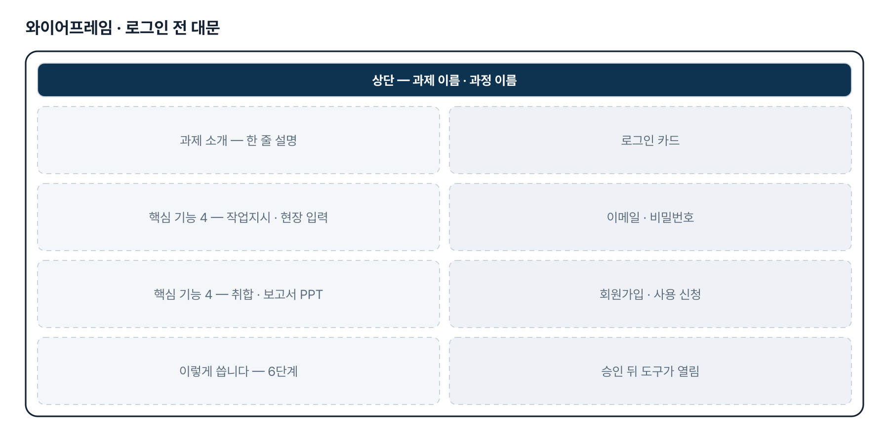
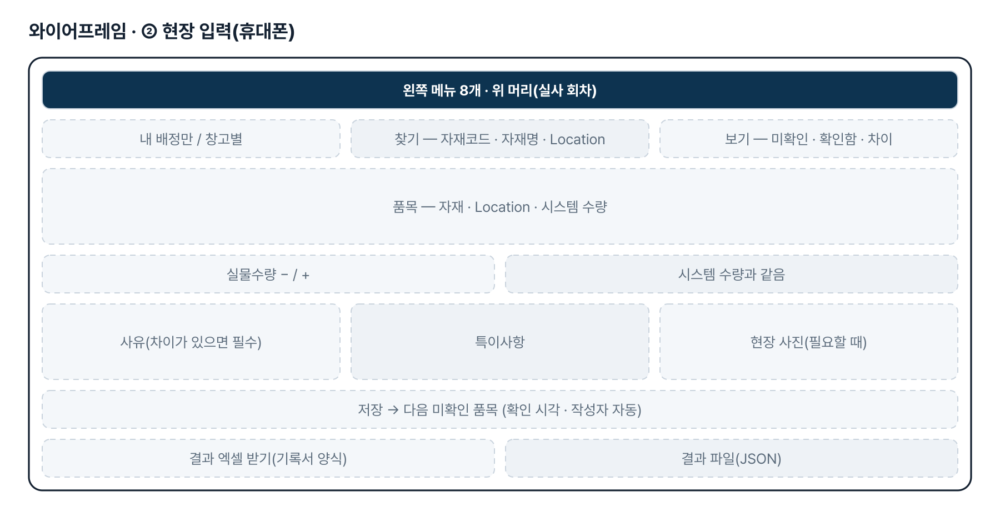
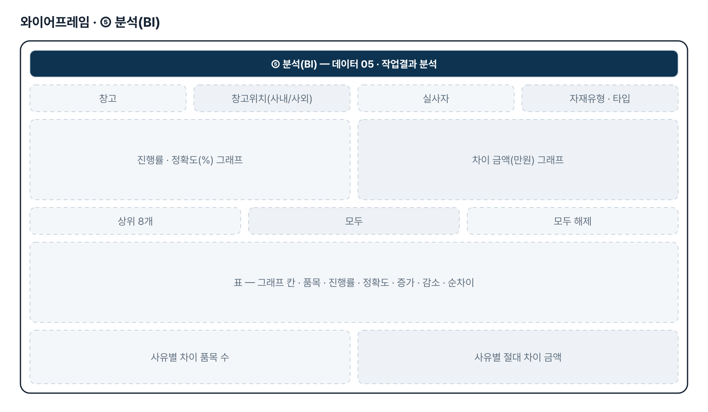
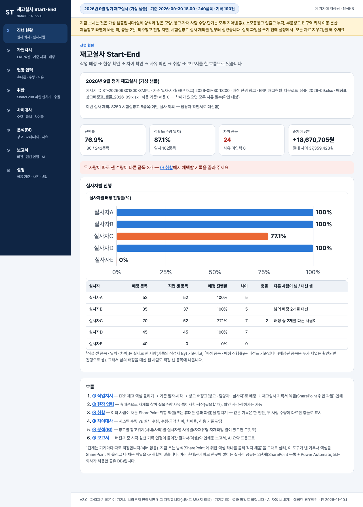

# 재고실사 Start-End — 프로젝트 기획서 v2.2

- 기획: 이미란 · 작성일 2026-11-10 · 현장 데이터 디지털화 전문가과정 · 2차수 프로젝트 14
- 바로 쓰기: https://miran.jobability.co.kr/
- 워드 판: `docs/기획서/data10-14_이미란_재고실사Start-End_기획서_v2.2.docx`

## 개요

ERP 재고 엑셀과 창고 배정표로 기준 일자·시각이 박힌 재고실사 기록서를 만들고, 휴대폰이나 SharePoint 엑셀로 적은 실물수량·사유를 합쳐 차이대사·분석과 버전이 있는 결과 보고서(PPT·엑셀)까지 잇는 브라우저 도구입니다.

### 배경 · 현재 업무
- 재고실사는 월 1회 「작업 배정 → 재고 시스템 수량과 현장 확인 → 차이 확인 → 사유 확인 → 취합 → 보고서 작성」 순서로 진행됩니다.
- ERP 재고를 엑셀로 내려받아 종이로 나눠 주고, 종이에 적은 수량을 다음 날쯤 엑셀로 다시 옮겨 취합하며, 보고서(pptx)는 실사 뒤 3~4일에 나옵니다.
- 작업지시서에 기준 일자·시각이 없고, 수량 기록에 사진·특이사항·작성자·확인 시각이 없으며, 차이 사유를 카테고리로 나누지 않습니다.
- 보고서에 버전과 원천 기록 연결(상세 내역이 어느 기록에서 왔는지)이 없습니다.

### 목표
- ERP 재고 엑셀을 올리는 것에서 작업지시를 출발하고, 기준 일자·시각을 반드시 남깁니다.
- 현장에서 휴대폰이나 SharePoint 엑셀로 실물수량·사유·특이사항·사진을 남기고, 확인 시각·작성자는 자동으로 붙입니다.
- 여러 사람의 결과를 한곳에 합쳐 차이대사와 창고별·창고위치별·실사자별·사유별 분석을 바로 봅니다.
- 버전·원천 기록 연결이 있는 결과 보고서를 직전 보고서 양식(pptx) 그대로 냅니다.

## 요구사항과 구현

| 기획서 요구 | 구현 |
|---|---|
| ERP 다운로드 엑셀(데이터 01)을 올려 작업지시 출발 | ERP 엑셀 올리기(머리행 자동 인식 · 열 연결 · 추가 열 보존), ERP 한 줄 = 작업지시 한 줄, 기준 일자·시각 필수 |
| 작업배정 시스템화 | 창고 배정표 올리기(실사인원 0 창고 제외 · 실사자 수만큼 나눔 · 담당자 기록) 또는 이름 목록 자동 배정 |
| 휴대폰으로 현장 재고실사 기록 | ② 현장 입력 — 휴대폰 폭 화면, 찾기 + 보기, 수량 +/−, 「시스템 수량과 같음」, 저장하면 다음 미확인 품목 |
| 차이 확인 · 사유 확인(사유 카테고리) | 차이가 있으면 사유 필수(기본 6개, 설정에서 고침), 허용 기준 기본 0 — ④ 차이대사에서 수량·금액·차이율 |
| 수량 근거 사진 · 특이사항 · 작성자 · 확인 시각 | 현장 사진(필요할 때만, 800px), 특이사항, 확인 시각·작성자 자동, ④ 에서 「사진 보기」 |
| 취합이 실시간으로 진행 | SharePoint 취합 엑셀 · 휴대폰 결과 파일을 ③ 취합에서 합치기(같은 기록은 한 번만, 충돌 고르기). 실시간 공유는 2단계 |
| 창고별·자재유형별·자재타입별 BI | ⑤ 분석 — 창고별 · 창고위치(사내/사외)별 · 실사자별 · 사유별 · 시간대별(자재유형·자재타입 열이 있으면 그것도), 고른 행만 그래프 |
| 최종 보고서(데이터 06) · 버전 · 원천 기록 연결 | ⑥ 보고서 — 발행 버전 v1·v2…, 기록 ID, 결과서 엑셀 · 인쇄/PDF · Word · 직전 보고서 pptx 에 내용만 바꾼 PPT |

## 주요 기능

- **작업지시 · 기록서** — ERP 재고 엑셀과 창고 배정표로 기준 일자·시각이 박힌 작업지시와 SharePoint 취합용 기록서 엑셀을 만듭니다.
- **휴대폰 현장 입력** — 실물수량을 적고 차이가 있으면 사유를 꼭 고릅니다. 사진·특이사항을 남기고 확인 시각·작성자는 자동입니다.
- **취합 · 차이대사** — SharePoint 파일과 휴대폰 결과를 합치고 충돌을 고른 뒤, 수량·금액 차이와 사유 미입력을 봅니다.
- **보고서 PPT · 결과서** — 직전 보고서 pptx 에 내용만 바꿔 넣고(상세 표가 여러 장이어도 장마다 표가 채워짐), 버전·기록 ID 가 있는 결과서 엑셀·Word 를 냅니다.
- **분석(BI)** — 창고별·창고위치(사내/사외)별·실사자별·사유별·시간대별 진행률·정확도·차이 금액. 표에서 고른 행만 그래프로 그립니다.
- **진행 현황** — 진행률·정확도·차이 품목·순차이, 실사자별 진행(배정 기준과 직접 센 품목 기준), 제외 창고, 미해결 충돌을 보여 줍니다.
- **AI 요약 프롬프트** — 실사자 이름을 가리고 자재명은 기본으로 빼서 결과 요약을 부탁하는 프롬프트를 만듭니다.
- **설정 · 백업** — 허용 기준(기본 허용 0), 사유 목록, 이 기기 작성자 이름, AI 연결, JSON 백업·되살리기.
- **로그인 · 사용 승인** — 회사 메일이나 개인 메일로 가입하고 사용 신청 → 관리자 승인 뒤 씁니다.

## 처리 흐름(파이프라인)

1. **로그인 · 승인** — 가입 · 사용 신청 뒤 관리자가 승인하면 도구가 열림
2. **작업지시** — ERP 재고 엑셀 · 기준 일자·시각 · 창고 배정표로 실사 회차를 만듦
3. **기록서 배포** — 기록서 엑셀을 SharePoint 에 올리거나 휴대폰에 넣음, 인쇄본도 가능
4. **현장 입력** — 실물수량 · 사유(차이가 있으면 필수) · 특이사항 · 사진
5. **취합 · 충돌** — SharePoint 파일 · 휴대폰 결과를 합치고 다른 수량은 골라 채택
6. **차이대사 · 분석** — 수량·금액 차이, 사유, 창고·창고위치·실사자·사유별 분석
7. **보고서 발행** — 버전 · 기록 ID 가 있는 결과서 엑셀 · Word · 보고서 PPT

## 구성(아키텍처)

- **화면 (index.html · js/app.js)** — 진행 현황 · 작업지시 · 현장 입력 · 취합 · 차이대사 · 분석(BI) · 보고서 · 설정
- **계산 (js/logic.js · js/pptx-report.js)** — ERP · 배정표 읽기 · 기록서 엑셀 만들기 · 다시 읽기 · 기록 합치기 · 충돌 · 차이대사 · 허용 기준 · 분석 · 실사자별 · 결과서 시트 · AI 프롬프트 · 보고서 PPT
- **저장** — localStorage 실사 자료 · 이 기기 작성자 · 기기 ID · JSON 백업 · 되살리기 · 결과 파일(JSON) · 결과 엑셀
- **로그인 · 승인** — js/auth.js · Supabase data1014_members · 사용 신청 · 관리자 승인
- **라이브러리 (vendor/)** — SheetJS — 엑셀 · JSZip — pptx · supabase.js — 로그인
- **검증 (test/ · scripts/)** — logic.test.mjs 58 · pptx.test.mjs 24 · check-browser.mjs 브라우저 점검 · sqltest — 2단계 DB 초안
- **배포** — miran.jobability.co.kr · 내 깃허브 Pages · 내 Supabase

## 화면 구성(와이어프레임)

## 규칙 · 판정 기준

- 차이수량 = 실물수량 − 시스템 수량 — 모자라면 −, 남으면 +. 기록서 엑셀 수식 · 화면 · 결과서 · 보고서 PPT 가 같은 방향입니다.
- 허용 기준 기본은 허용 0 — 차이가 하나라도 있으면 사유 확인 대상입니다. 차이율 · 금액 허용은 설정에서 고를 때만 쓰고, 사유 필수는 어느 방식이든 그대로입니다.
- ERP 한 줄 = 작업지시 한 줄. 같은 재고번호가 또 나와도 합치지 않고 「#2」 「#3」 으로 남깁니다.
- 배정표에서 실사인원 0 창고는 이번 실사에서 빼고, 실사자가 여럿이면 그 창고를 Location 순서로 사람 수만큼 나눕니다.
- 기록 ID 는 내용(재고번호 · 작성자 · 수량 · 사유 · 확인시각)으로 만듭니다. 같은 파일을 여러 번 넣어도 한 번만 들어가고, 다른 사람끼리 수량이 다르면 충돌, 같은 사람이 다시 센 것은 정정입니다. 다른 실사 회차 파일은 거절합니다.
- 실사자별 집계 — 배정 품목 · 배정 진행률은 배정표 기준, 직접 센 품목 · 일치 · 차이 · 금액은 기록의 작성자(By) 기준입니다.
- 보고서 PPT 실사 현황의 실사완료 금액 = 실물수량 × ERP 단가. 보고서는 발행할 때마다 v1, v2 … 로 버전이 오릅니다.

## 검증

- 계산 규칙 테스트 58개 통과
- 보고서 PPT 시험 test/pptx.test.mjs 25개 통과(새 1개: think-cell 태그가 붙은 직전 보고서 — 상세 표 N장 모두 행이 있고 장마다 태그 파트를 따로 가짐). 고침을 빼면 이 시험이 실패하는 것을 확인했습니다.
- 브라우저 점검 scripts/check-browser.mjs 모두 통과(2026-11-10 v2.2, 360 · 1280px 넘침 0 · JS 오류 0).
- PowerPoint 에서 직접 열어 확인하지는 못했습니다(이 PC 에 없음). 원인은 파일 구조로 판단했고 LibreOffice 로는 모든 장이 보입니다 — 요청자 재확인이 필요합니다.

## 이번 판에서 하지 않는 것

- 업무 자료는 아직 팀 공유 DB 가 아니라 기기마다 브라우저(localStorage)에 저장합니다. 주소만 열면 빈 화면이고, 기록서 엑셀 → 결과 파일 → ③ 취합으로 모읍니다.
- 실시간 취합은 하지 않습니다. 2단계 DB 초안 supabase/schema.sql 은 앱과 연결하지 않았습니다.
- 사진은 기기 안에 두고, 결과 파일(JSON)에 「사진도 넣기」를 골랐을 때만 사무실로 옮겨집니다. 비공개 사진 저장소는 없습니다.
- ERP 와 바로 연결하지 않습니다(내려받은 엑셀을 올림).
- 견본 ERP 에는 자재유형 · 자재타입 열이 없어, 열이 추가되어야 그 기준의 분석이 보입니다.

## 다음 단계

- 팀 공유 저장 — SharePoint 목록 + Power Automate, 또는 공유 DB(supabase/schema.sql 초안)로 실시간 취합
- 사진을 비공개 저장소에 두고 기록과 연결
- 지난 회차와 비교(같은 품목 · 같은 사유가 반복되는지)
- 라벨 바코드 · QR 로 재고번호 찾기, ERP 조정 전표 형식 내보내기

## 버전 이력

- **v2.2** (2026-11-10) — 보고서 PPT — 직전 보고서로 만들 때 상세 표 2장째부터 빈 장이 되던 결함 고침(장마다 도형 태그 파트를 따로 복사) / 도구 화면 전체 색 — 대표색 #005EB8 · 짙은 남색 왼쪽 메뉴 · 옅은 하늘색 바탕(css/theme-brand.css)
- **v2.0** (2026-11-10) — 최종 기획서 — 파이프라인 · 아키텍처 · 와이어프레임 정리 / 로그인 · 사용 신청 · 관리자 승인(요청자 Supabase 로 옮길 수 있게) / 로그인 전 대문
- **v1.4** (2026-11-08) — 5차 — BI 그래프 행 고르기(창고 이름만) / 실사자별 By 기준 / 차이대사 사진 보기 / 직전 보고서 PPT 여러 장(줄 · 슬라이드 번호 겹침 고침) / 여러 사람 현장 입력 순서 안내
- **v1.3** (2026-10-28) — 4차 — ERP 줄마다 한 줄(합치지 않음) / 천 단위 쉼표 · yyyy-mm-dd / 현장 찾기 + 보기 함께
- **v1.2** (2026-10-27) — 3차 — 직전 보고서 pptx 에 내용만 바꾼 보고서 PPT / 차이수량 「모자라면 −」(실물 − 시스템) / 실사완료 = 실물 × ERP 단가 · 실사 현황 기본 행 = 자재타입 / 판 맞추기(?v= · fresh-guard)
- **v1.1** (2026-10-21) — 2차 — ERP 견본 열 · 창고 배정표 · 허용 0 · SharePoint 취합 파일 · 사유 목록 설정
- **v1.0** (2026-10-21) — 1단계 — 작업지시 · 현장 입력 · 취합 · 차이대사 · 분석 · 보고서
